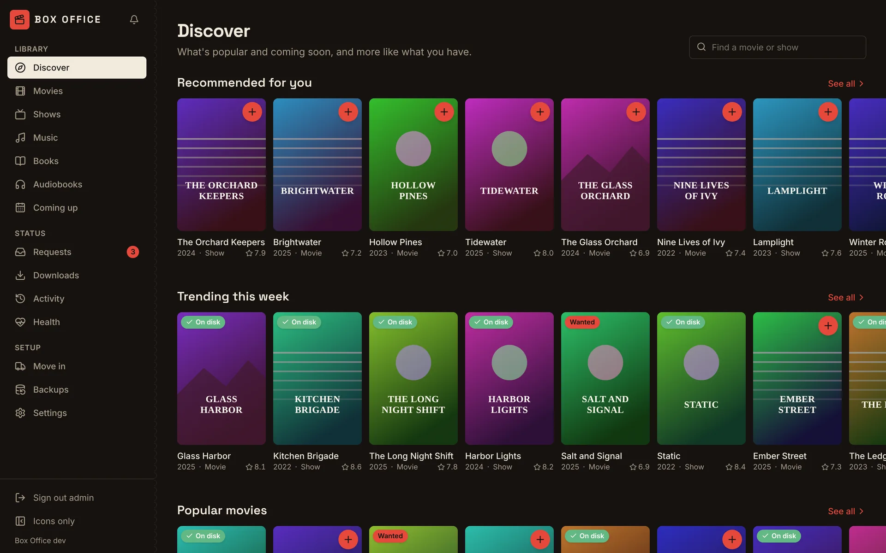
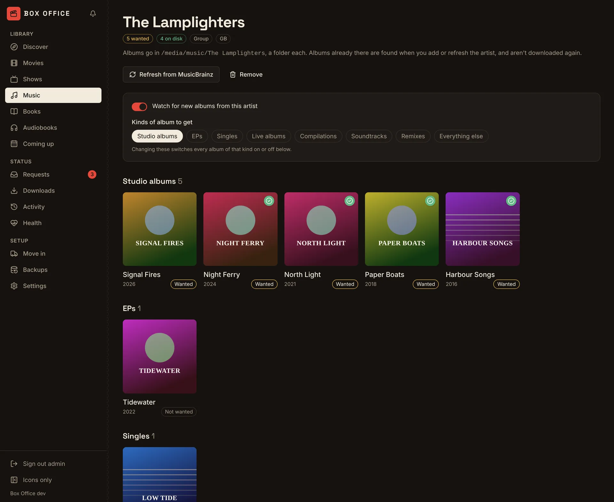
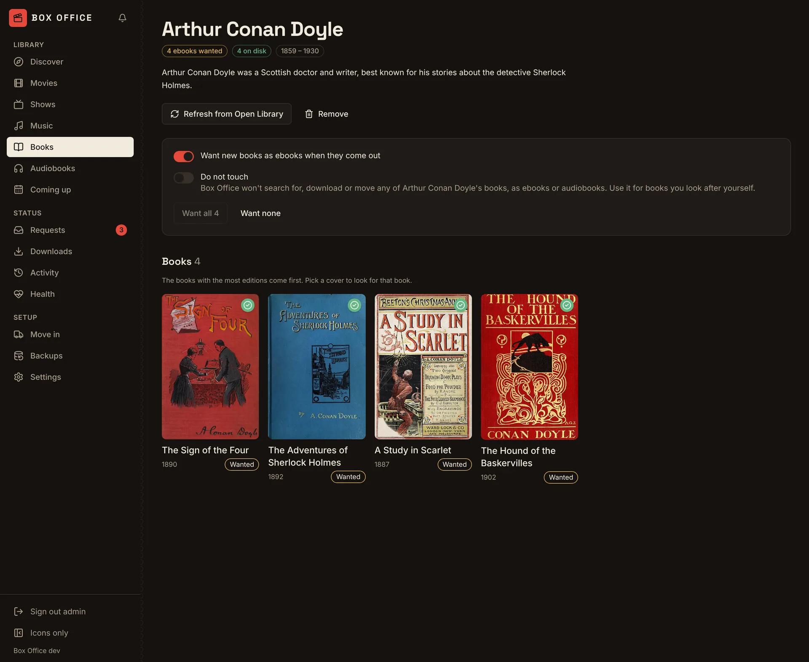
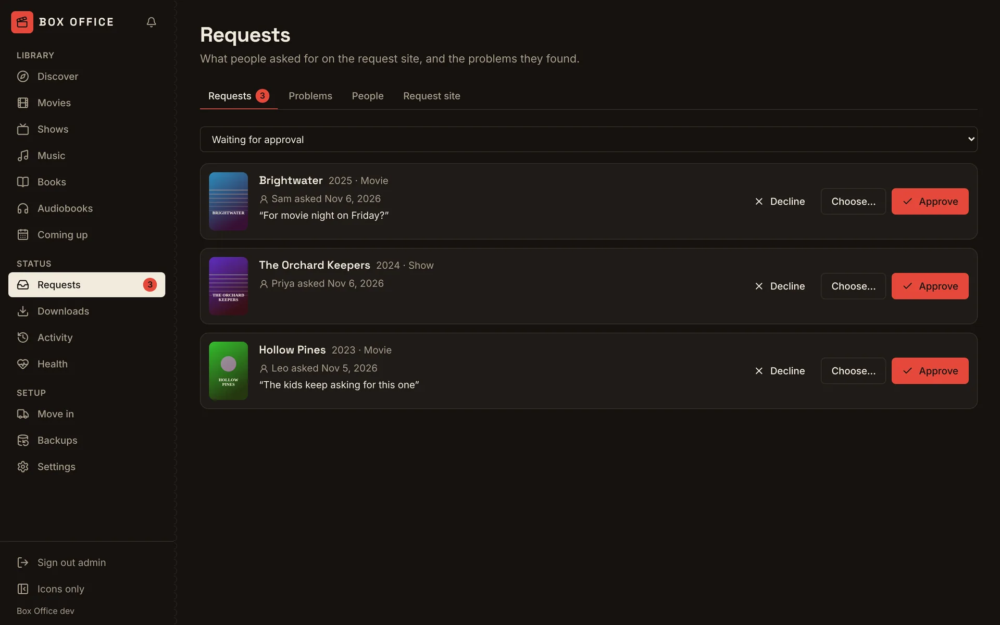
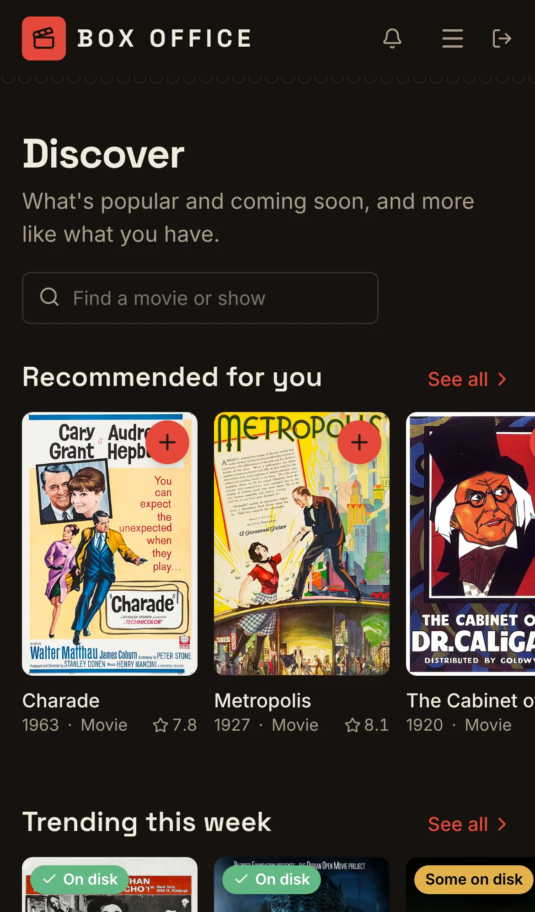
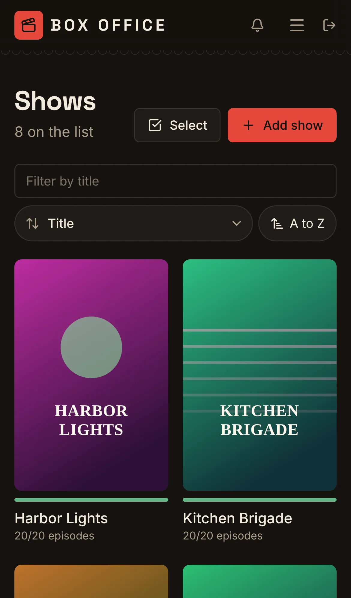
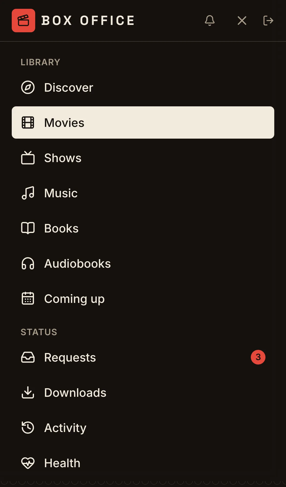
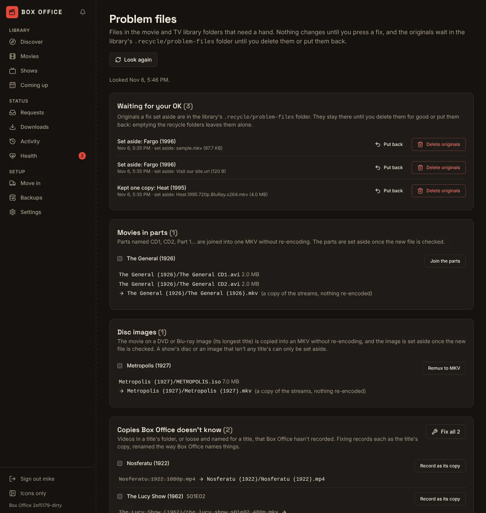
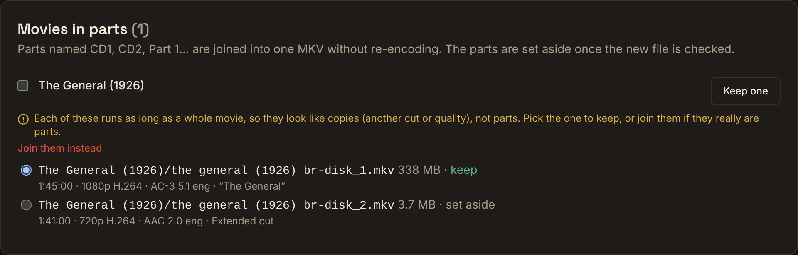

<p align="center">
  
</p>

<p align="center">
  <b>A self-hosted manager for your own movie and TV library.</b><br>
  One app in place of Radarr, Sonarr and NZBGet, made to sit next to <a href="https://github.com/yeixio/matinee">Matinee</a>.
</p>

<p align="center">
  <a href="https://github.com/yeixio/boxoffice/actions/workflows/ci.yml"></a>
  <a href="LICENSE"></a>
  <a href="https://github.com/yeixio/boxoffice/pkgs/container/boxoffice"></a>
  <a href="go.mod"></a>
  <a href="https://github.com/yeixio/boxoffice/issues?q=is%3Aissue+is%3Aopen+label%3A%22good+first+issue%22"></a>
</p>

Box Office keeps track of the movies and shows in your library and the ones you're waiting for. It fetches files from the Usenet services you connect it to, checks them for malware and damage, and files them into tidy folders that any media server can play. When a better-quality copy turns up, it swaps it in and keeps the old one in a recycle folder.

Already running Radarr, Sonarr, Lidarr, Readarr or NZBGet? **Move in** brings everything over step by step, and only ever reads from the old apps, so nothing in them changes until you decide to turn them off.



<p>
  
  
</p>

<p>
  
  
</p>

<p>
  
  
</p>

<p align="center">
  
  
  
</p>

<sub>The screenshots use public-domain and Creative Commons films, cartoons, sheet music and books. Artwork from Wikimedia Commons; see [the credits](docs/images/CREDITS.md).</sub>

**Status:** early, and moving fast. Movies, TV, the built-in Usenet downloader and moving in from Radarr, Sonarr and NZBGet work end to end. There are no tagged releases yet: the `main` image is built from every change that passes CI. See the [roadmap](ROADMAP.md) for what's next.

## Responsible use

Box Office is a library manager. It doesn't come with any content, indexers or news servers, and it doesn't link to, recommend or bypass the protections of any service. You connect it to services you have an account with, and you're responsible for having the right to download and keep what you add, such as recordings you made, discs you own where the law where you live allows a personal copy, public-domain films and Creative Commons works, or content a provider licenses you to download. Please respect copyright and your providers' terms. Issues and pull requests that link to or ask for help finding infringing content will be closed.

## Contents

- [Responsible use](#responsible-use)
- [Try it in one line](#try-it-in-one-line)
- [What it does](#what-it-does)
- [The request site](#the-request-site)
- [Works with Matinee](#works-with-matinee)
- [Run it](#run-it): [Versions](#versions), [Docker](#docker), [Docker Compose](#docker-compose), [Kubernetes](#kubernetes), [from source](#from-source)
- [Moving in from Radarr, Sonarr, Lidarr, Readarr and NZBGet](#moving-in-from-radarr-sonarr-lidarr-readarr-and-nzbget)
- [Configuration](#configuration)
- [FAQ](#faq)
- [How it's built](#how-its-built)
- [Ecosystem](#ecosystem)
- [Contributing](#contributing)
- [Releasing](#releasing)

## Try it in one line

```sh
mkdir -p data && docker run -d --name boxoffice -p 7272:7272 --user "$(id -u):$(id -g)" -v ./data:/data ghcr.io/yeixio/boxoffice:latest
```

Open http://localhost:7272 and make the admin account. To have it file things into your library, mount your folders too: see [Docker](#docker).

## What it does

- **Discover what to watch.** The home page shows what's trending, popular and coming soon on TMDB, recommendations based on your library, and genres and networks to browse. Each poster says whether it's already on disk or wanted, and the **+** on it adds the title in one click.
- **Movies and shows you want.** Add a title by name and Box Office looks it up on [TMDB](https://www.themoviedb.org/): poster, description, rating, and for shows every season and episode. Each title has a quality profile, a folder, and a switch to watch for it. **Coming up** lists new episodes and movies on their way.
- **Searches on its own.** RSS sync reads each connected indexer's newest listings every 15 minutes, so new episodes are found when they become available. An hourly library patrol looks for a few missing titles and upgrades at a time, newest first, and looks for a whole season when three or more of its episodes are wanted.
- **Kind to the services you use and your data plan.** Searches are spaced out and kept under each indexer's daily limit (read from the indexer when it says, or typed in), an indexer that's having trouble rests for a while, and a monthly **data cap** makes upgrades wait first, then missing titles, before you hit your internet provider's limit. Block accounts on news servers count down too.
- **A Usenet downloader built in.** No NZBGet or SABnzbd needed: Box Office connects to your news servers, downloads, checks and repairs with par2, and unpacks RAR archives, including multi-part sets in the older `.r00` style and sets whose file names don't say what's inside. Add an NZB yourself on the Downloads page, pause, reorder, retry, and act on many at once.
- **Checks what it downloaded.** Before anything reaches your library, Box Office looks inside: executables and other malware risks, files whose contents don't match their names, downloads with no video, and videos much shorter than the movie or episode they're meant to be go to quarantine instead, that result is blocked, and another one is looked for. You can look through quarantine, release something from it, or delete it.
- **Files things neatly.** Finished downloads are moved into the title's folder, copied and checked by size first when the downloads folder is on another share. A file browser on the Downloads page lets you tidy the downloads folder or move a folder into a title by hand.
- **Upgrades without losing anything.** When a copy is below its profile's good-enough quality, Box Office keeps looking. A better copy replaces the old one, which goes to the library's `.recycle` folder. Empty those folders from Settings, or have them emptied after a number of days.
- **Choose a copy yourself.** Every movie, episode and season has **Choose a release**: the results from every connected indexer, with their quality, size and age, and why any were turned down.
- **Removes titles cleanly.** Removing a movie, show, season or episode can also delete its files from disk. You see the folder, the number of files and their size first, and Box Office deletes only what it showed you.
- **Problem files.** **Settings → Problem files** looks through the movie and TV library folders for what's out of place: folders and videos that aren't any title on the list, copies Box Office hasn't recorded, more than one copy of a movie or episode, recorded files that are gone, DVD and Blu-ray images (`.iso`, `.img`), movies split into parts (CD1, CD2…), names and folders that don't say what's in them, leftovers such as samples, programs and partial downloads, and empty folders. Each one shows what its fix does before you press it: a rename to `Title (Year)` (episodes into `Season 01` as `Title (Year) - S01E02 - Episode`, subtitles along), recording a copy, keeping the copy you pick, or remuxing a disc image or the parts into one MKV with FFmpeg, copying the streams as they are. Copies and parts show how long each runs, its picture, sound, subtitles and cut, so you can tell another edition from a real part; parts that each run as long as a movie are offered as copies to keep one of, with joining still there to pick. A new file is checked (it opens, it's as long as what it came from, it has its sound) before anything else moves. Nothing is deleted: originals go to the library's `.recycle/problem-files` folder and wait there, untouched by the recycle folders' emptying, until you press **Delete originals** or **Put back**, which also undoes renames and records. Titles on Do not touch, and library folders mounted read-only, are listed but not changed. The look runs by itself every day, and when it finds something new it sends an alert (the **The daily look finds problem files** rule under **Health → Alerts**).

  
  

- **Sorts and filters** movies and shows by title, rating, size on disk, date added, and for shows by the next or last episode, remembered per list.
- **Ebooks straight to your e-reader.** Each ebook Box Office downloads can be emailed to your Kindle, PocketBook or any reader with an email address, as soon as it's in the library. See [Sending ebooks to e-readers](docs/ereaders.md).
- **Health.** A check-up of the things that stop Box Office working (disks, folders it can't write to, indexers, news servers), live charts of the processor, memory, requests and download speed, the log with a debug switch, and alerts. Prometheus metrics are at `/metrics` once you make a token.
- **Backups** of its database on a schedule, to its own disk and optionally to another folder (such as a NAS share) or S3-compatible storage (AWS S3, Backblaze B2, Cloudflare R2, MinIO). A passphrase encrypts them. Restore from the Backups page.
- **Works on a phone.** Every page is built to work at phone width, in light and dark.

## The request site

Box Office has its own site where family and friends ask for movies and shows, in place of Overseerr. Turn it on in **Requests → Request site**.

- **It's at `/request`** on your Box Office address with nothing else to set up, for example `http://boxoffice.home:7272/request`. If you give it its own host name (such as `requests.example.com`) and point that name at Box Office, the site answers on that whole name, and the admin pages stay off it.
- **Your name, colour and logo.** Give it a name, a welcome line, an accent colour and a logo.
- **Signing in.** People sign in with their Matinee account when you give the Matinee address (Box Office checks the password with Matinee and keeps nothing of Matinee's), or with an account you make for them here. You can let people make their own account too. Request site accounts are separate from the admin account and never open the admin pages or API.
- **Asking.** People browse the same Discover rows and search, ask for a title with an optional note, and follow it on **My requests**: waiting for approval, looking for it, downloading with how far along, ready to watch.
- **Approving.** New requests wait on the **Requests** page for you to approve (with your usual profile, or other choices) or decline with a reason. Approval can be automatic for everyone or for chosen people, and weekly limits for movies and shows can be set for everyone and changed per person.
- **Problems.** People can report a problem with something in the library (it won't play, the wrong episode, bad picture, sound or subtitles). Reports land on the **Problems** tab with a link to the title, where **Choose a release** finds another copy; mark it fixed with a note and the person sees it.

## Works with Matinee

Box Office is the other half of [Matinee](https://github.com/yeixio/matinee), the free and open-source media server. Box Office gets the movies and shows; Matinee plays them.

<p align="center">
  <a href="https://github.com/yeixio/matinee"></a>
</p>

- **One connection.** In Matinee, open **Settings → Add-ons** and click **Connect** next to **Box Office**. Matinee finds it by itself in most setups; paste the API key from Box Office's **Settings → Connect Matinee**, then **Test** and **Save**. [Matinee's guide](https://github.com/yeixio/matinee/blob/main/docs/guide/server/radarr-and-sonarr.md#box-office) has the details.
- **Requests and coming soon.** People ask for movies and shows in Matinee's web player and apps, an admin approves, and Box Office finds them. Everyone sees what's coming in Matinee's Coming soon.
- **Notifications.** Matinee tells the person who asked when their title is found and when it's ready to watch, in the web player and the phone and TV apps. Admins hear about failed and quarantined downloads too.
- **Moving in switches Matinee over for you,** if you like: the last step of Move in points Matinee at Box Office in place of Radarr and Sonarr.

Box Office answers on Radarr's and Sonarr's APIs at `/radarr` and `/sonarr`, so tools built for Radarr or Sonarr can talk to Box Office too. Matinee is the one tested so far; reports on others (Overseerr, Jellyseerr, Home Assistant) are welcome. Matinee is optional, so Box Office fits Plex and Jellyfin setups as well.

## Run it

Box Office is one small binary with its web UI built in. The image is Debian slim with FFmpeg, which Problem files uses to remux disc images and join movies in parts; nothing is ever re-encoded. It listens on port **7272**.

Box Office needs to **write** to your library folders, because it files new downloads there. Mount them at the same paths Matinee (or Plex, or Jellyfin) sees them at if you can; then every app agrees on where a file is.

### Versions

Each release is a GitHub release with its notes, tagged `vX.Y.Z`, and publishes these images (amd64 and arm64):

| Tag | What it is |
|-----|------------|
| `ghcr.io/yeixio/boxoffice:latest` | The newest stable release. |
| `ghcr.io/yeixio/boxoffice:0.2.0`, `:0.2` | One release, or the newest in a minor version. |
| `ghcr.io/yeixio/boxoffice:main` | What just merged to `main`. Newer, but less tried; for testing. |

Pre-releases (`v0.2.0-beta.1`) get their own tag and leave `latest` alone. The Helm chart is published with each release as `oci://ghcr.io/yeixio/charts/boxoffice`, and defaults to that release's image.

### Docker

```sh
docker run -d --name boxoffice \
  -p 7272:7272 \
  --user "$(id -u):$(id -g)" \
  -v ./data:/data \
  -v /path/to/movies:/media/movies \
  -v /path/to/tv:/media/tv \
  -v /path/to/downloads:/downloads \
  -e BOXOFFICE_DOWNLOADS_DIR=/downloads \
  ghcr.io/yeixio/boxoffice:latest
```

Open http://localhost:7272, make the admin account, then in **Settings**:

1. Add `/media/movies` and `/media/tv` as root folders.
2. Official images come with a TMDB key for posters and details. If you built Box Office yourself, paste a free [TMDB key](#faq).
3. Under **Downloads**, add a news server and an indexer, then turn on **Download releases**.

Or skip those and [move in](#moving-in-from-radarr-sonarr-lidarr-readarr-and-nzbget) from Radarr, Sonarr, Lidarr, Readarr and NZBGet, which brings all of it over.

`--user` makes Box Office run as you, so the files it writes are yours and it can write to folders you own. Without it, the container runs as user 65532. Make `./data` yourself first (`mkdir -p data`), or Docker makes it owned by root.

### Docker Compose

[`docker-compose.yml`](docker-compose.yml) runs Box Office and Matinee side by side, sharing the same library folders:

```sh
curl -fsSLO https://raw.githubusercontent.com/yeixio/boxoffice/main/docker-compose.yml
# change the /path/to/... folders in it, then:
mkdir -p boxoffice-data matinee-data
docker compose up -d
```

Box Office is at http://localhost:7272 and Matinee at http://localhost:7171. In Matinee, **Settings → Add-ons → Box Office** finds it at `http://boxoffice:7272`. Don't want Matinee? Delete its service from the file.

### Kubernetes

Each release publishes the Helm chart (its source is in [`deploy/helm/boxoffice`](deploy/helm/boxoffice)):

```sh
helm install boxoffice oci://ghcr.io/yeixio/charts/boxoffice -f my-values.yaml
```

Add `--version 0.1.0` to pin a release; the chart runs the image of the same version.

A small `my-values.yaml`:

```yaml
media:
  - name: movies
    mountPath: /media/movies
    volume:
      nfs: { server: nas.local, path: /export/movies }
  - name: tv
    mountPath: /media/tv
    volume:
      persistentVolumeClaim: { claimName: tv-library }

downloads:
  volume:
    persistentVolumeClaim: { claimName: downloads }

ingress:
  enabled: true
  hosts:
    - host: boxoffice.example.com
      paths: [{ path: /, pathType: Prefix }]
```

The chart runs one pod with SQLite on its own volume by default. Set `postgresql.enabled=true` for a bundled PostgreSQL (its password is made into a Secret on first install, so it works the same under Argo CD or Flux), or `database.url` for your own. Set `apiKey.existingSecret` and `tmdb.existingSecret` to manage keys with the cluster. Mount the same volumes Matinee reads, at the same paths. Everything else is in [`values.yaml`](deploy/helm/boxoffice/values.yaml).

Set `image.tag=main` to follow `main` instead. A reverse proxy or ingress in front of Box Office should allow long requests (an hour is plenty), because a big Move in preview takes a while.

### From source

Needs Go 1.26+ and Node 22 with pnpm.

```sh
git clone https://github.com/yeixio/boxoffice.git
cd boxoffice
make run    # builds the web UI and server, then serves http://localhost:7272 with data in ./data
```

## Moving in from Radarr, Sonarr, Lidarr, Readarr and NZBGet

**Move in** (in the top bar) brings over everything an old app knows, one app at a time, without changing it:

1. **Connect.** Box Office looks for Radarr, Sonarr, Lidarr, Readarr and NZBGet on their usual addresses and on this machine, and says what it found. Pick one, or type the address. Lidarr shows once Music is on in Settings, and Readarr once Ebooks or Audiobooks are. For Radarr, Sonarr, Lidarr and Readarr, paste the API key from the app's **Settings → General**; NZBGet uses its own username and password.
2. **Look it over.** Box Office reads the app and shows what would come across: how many titles are new, how many it already has, any it can't bring and why, and whether it can see the files at the paths the app uses. If the old app sees your library at another path (`/movies` there, `/media/movies` here), it works out the mapping from your mounts, or you can set it.
3. **Move in.** Box Office can back itself up first, so you can undo with a restore, and can ask the old app to back itself up and keep that copy. Then it brings over titles and their files, quality profiles, root folders, indexers, download clients, news servers, the blocklist, and the app's other settings. Radarr, Sonarr, Lidarr and Readarr hide passwords and API keys from other apps; Box Office reads them from that backup, so keep it on. From Lidarr come its artists, the albums they want, and each album it has, recorded where it is; Lidarr's quality profiles stay behind, since music has its own quality setting. From Readarr come its authors, looked up on Open Library by name, with the books it wants and the copies it has; Box Office tells a root folder of ebooks from one of audiobooks by its files.
4. **Matinee** (optional). Point Matinee at Box Office in place of Radarr and Sonarr, with an admin sign-in to Matinee that's used once and not kept. Skip this if you use Plex or Jellyfin.
5. **Done.** Your files stay exactly where they were: Box Office records them, it doesn't move them. Run both side by side for as long as you like, then turn the old app off.

Moving in again later is safe: titles already here are left as they are, and their ratings and details are filled in.

Don't use one of the apps? Press **Skip** next to it, on the overview or under its Connect form, and Move in stops asking for it. **Undo** brings it back.

## Configuration

Most settings live in the web UI under **Settings**. The server itself takes a few flags or environment variables:

| Variable | Flag | Default | What it does |
| --- | --- | --- | --- |
| `BOXOFFICE_ADDR` | `-addr` | `:7272` | Listen address |
| `BOXOFFICE_DATA_DIR` | `-data` | `/data` in the image | Database (with SQLite), backups and the backups of apps you move in from |
| `BOXOFFICE_DATABASE_URL` | `-database-url` | empty | `postgres://…` to use PostgreSQL instead of SQLite |
| `BOXOFFICE_DOWNLOADS_DIR` | `-downloads` | `downloads` in the data folder | Where downloads go while they're fetched, checked and unpacked. Give it room for a few releases, and never point it inside a library |
| `BOXOFFICE_TMDB_KEY` | | built-in key in official images, else empty | A TMDB key, used when none is saved in Settings |
| `BOXOFFICE_API_KEY` | | made on first start | Fixes the API key Matinee and other apps use, such as from a Kubernetes Secret |
| `BOXOFFICE_REFRESH_EVERY` | `-refresh-every` | `12h` | How often titles are refreshed from TMDB (at least `1h`) |
| `BOXOFFICE_MUSICBRAINZ_URL` | | `https://musicbrainz.org/ws/2` | A MusicBrainz mirror to look music up on, if you run one |
| `BOXOFFICE_OPENLIBRARY_URL` | | `https://openlibrary.org` | Another Open Library to look books up on, if you run one |
| `BOXOFFICE_EBOOK_CONVERT` | | `ebook-convert` on the `PATH`, if there | Calibre's `ebook-convert`, so ebooks a Kindle won't take by email (AZW3, MOBI) are turned into EPUB before they're sent. See [Sending ebooks to e-readers](docs/ereaders.md) |
| `BOXOFFICE_LOG_FORMAT` | `-log-format` | `text` | `text` or `json` |
| `BOXOFFICE_DEBUG` | `-debug` | off | Log more. The Health page can also switch debug logging on and off while it runs |

**SQLite or PostgreSQL?** SQLite is the default and needs nothing else, as long as the data folder is on a local disk. Use PostgreSQL when the data would otherwise live on network storage, where SQLite's locking isn't reliable.

Kubernetes probes are at `/healthz` (process up) and `/readyz` (database reachable). The image runs `/boxoffice healthcheck` as its Docker health check.

## FAQ

<details>
<summary><b>Where does the content come from?</b></summary>

From services you choose and connect yourself. Box Office ships with no indexers, news servers or content, and doesn't suggest any. It's up to you to use it only for media you have the right to download and keep; see [Responsible use](#responsible-use).
</details>

<details>
<summary><b>Do I need Matinee?</b></summary>

No. Box Office works on its own and files things into ordinary folders, so Plex, Jellyfin, Emby or anything else can play them. Because it answers on Radarr's and Sonarr's APIs, request tools like Overseerr or Jellyseerr can point at `http://boxoffice:7272/radarr` and `/sonarr` with Box Office's API key (only Matinee has been tested this way so far). With Matinee you also get requests, notifications and the one-click connection.
</details>

<details>
<summary><b>Will moving in change or break my Radarr, Sonarr or NZBGet?</b></summary>

No. Box Office only reads from them. The one thing it asks for is a backup of the app itself, which it downloads and keeps. Files aren't moved or renamed. Keep the old app running until you're happy, but don't let both download the same titles: once Box Office's **Download releases** is on, turn off searching in the old app.
</details>

<details>
<summary><b>Can I show it on a dashboard like Homepage?</b></summary>

Yes. `GET /api/v1/stats`, with the API key in an `X-Api-Key` header, gives a short summary as JSON: `movies`, `moviesOnDisk`, `moviesMissing`, `series`, `episodes`, `episodesOnDisk`, `episodesMissing`, `downloading`, `queued`, `speed` (bytes a second) and `problems` (Health issues to fix, checked every 5 minutes at most). In [Homepage](https://gethomepage.dev) it fits the custom API widget:

```yaml
- Box Office:
    href: https://boxoffice.example.com
    icon: mdi-ticket-confirmation-outline
    widget:
      type: customapi
      url: http://boxoffice:7272/api/v1/stats
      headers:
        X-Api-Key: your-api-key
      mappings:
        - {field: movies, label: Movies, format: number}
        - {field: series, label: Shows, format: number}
        - {field: downloading, label: Downloading, format: number}
        - {field: problems, label: To fix, format: number}
```
</details>

<details>
<summary><b>Does it do torrents?</b></summary>

Not yet. Torznab indexers and torrent clients can be moved in and are kept, but Box Office only downloads from Usenet for now. Torrent support is on the [roadmap](ROADMAP.md).
</details>

<details>
<summary><b>Where do I get a TMDB key?</b></summary>

You only need one if you built Box Office yourself: the official images come with the project's key. Sign up at [themoviedb.org](https://www.themoviedb.org/signup), open [Settings → API](https://www.themoviedb.org/settings/api), click **Create** and answer **Yes** to personal use. Copy the **API Key** (or the Read Access Token) into Box Office's **Settings → TMDB**. Box Office checks it and fills in artwork right away. Moving in from Radarr or Sonarr works without a key; artwork then comes from what those apps knew.
</details>

<details>
<summary><b>Will it use up my data allowance or overload my indexers?</b></summary>

It's built not to. Searches are spaced two seconds apart and kept under each indexer's daily limit with a reserve for searches you start yourself; an indexer that errors or says "too many requests" rests and is tried again later. The monthly data cap is on by default at 3 TB: upgrades wait at 70%, missing titles at 90%, and downloads stop at 100%. Change all of it under **Settings → Downloads**.
</details>

<details>
<summary><b>Is anything ever deleted without asking?</b></summary>

Only under rules you can see and change. Replaced copies go to `.recycle` folders, which are kept until you empty them (or after a number of days you set). Downloads that fail beyond repair are deleted from the downloads folder unless you turn that off. Quarantined downloads are kept until you delete them, or for a number of days you set. Removing a title deletes its files only when you tick the box, and only the files the dialog showed you.
</details>

<details>
<summary><b>Can I run it on a NAS or Raspberry Pi?</b></summary>

Yes. The image is built for `linux/amd64` and `linux/arm64` and uses little memory, since it doesn't transcode anything. Unpacking big releases is mostly disk work, so put the downloads folder on a fast disk with room to spare.
</details>

<details>
<summary><b>Is there music, books or a request page of its own?</b></summary>

Yes. Music (in place of Lidarr), ebooks and audiobooks (in place of Readarr) each turn on in Settings, and the request site at `/request` is for people who don't use Matinee. Lidarr's artists and Readarr's authors come across with Move in.
</details>

<details>
<summary><b>Can it send ebooks to my Kindle or PocketBook?</b></summary>

Yes. In **Settings → Send to e-readers**, paste your reader's Send to Kindle or Send-to-PocketBook address and approve Box Office as a sender. Each ebook it downloads is then emailed to the reader, and any book can be sent from its page. Kobo readers can't receive books by email. [Sending ebooks to e-readers](docs/ereaders.md) walks through it step by step.
</details>

<details>
<summary><b>Where do I report a problem?</b></summary>

[Open an issue](https://github.com/yeixio/boxoffice/issues/new/choose) with the version (shown at the bottom of each page) and what happened. The **Health → Log** tab can download the log; take out API keys, passwords and addresses before you paste it. Security problems go through [SECURITY.md](SECURITY.md).
</details>

## How it's built

One Go binary with the React web UI embedded. It stores everything in SQLite or PostgreSQL.

```
cmd/boxoffice          entry point
internal/api           HTTP API for the web UI, auth, serves the UI
internal/arrapi        Radarr- and Sonarr-compatible API at /radarr and /sonarr
internal/migrate       Move in: reading Radarr, Sonarr, Lidarr, Readarr and NZBGet, previews, path maps
internal/search        Newznab searches, RSS sync, library patrol and indexer pacing
internal/downloader    the download queue, data cap, checks and moving into the library
internal/usenet        NNTP, yEnc, NZB, par2 repair, RAR unpacking and release screening
internal/catalog       movies, shows and episodes, and TMDB refreshes
internal/quality       qualities and profiles
internal/backup        backups to disk, another folder and S3, with encryption
internal/health        the check-up; internal/monitor and internal/alerts for the rest of Health
internal/notify        events Matinee passes on as notifications
internal/store         SQLite / PostgreSQL storage and migrations
web/                   React + Vite web UI
deploy/helm/boxoffice  Helm chart
```

The API under `/api/v1` is plain JSON over HTTP. `GET /api/v1/status` needs no sign-in and says which Box Office this is, which is how Matinee finds it.

## Ecosystem

Box Office is one of a family of free, self-hosted apps for the home. Each works on its own, and they're built to sit side by side:

| Project | What it does |
|---------|--------------|
| [**Matinee**](https://github.com/yeixio/matinee) | A fast, open-source media server for your movies, TV, music, audiobooks and podcasts, with web, phone and TV apps. |
| **Box Office** (this repository) | Manages your movie and TV library in place of Radarr, Sonarr and NZBGet, and plugs straight into Matinee. |
| [**Air-Mixer**](https://github.com/yeixio/air-mixer) | One home for every speaker you own: receives, routes and mixes audio across speakers from different ecosystems, starting with AirPlay in both directions. |

## Contributing

Box Office is young, which makes it a good time to get involved: small fixes land quickly and big pieces (torrents, music, books, the request page) are still open to shape.

- **Start small.** Issues labeled [good first issue](https://github.com/yeixio/boxoffice/issues?q=is%3Aissue+is%3Aopen+label%3A%22good+first+issue%22) are well scoped and say where to start. [help wanted](https://github.com/yeixio/boxoffice/issues?q=is%3Aissue+is%3Aopen+label%3A%22help+wanted%22) has bigger ones.
- **No code needed.** Moving in from an unusual Radarr or Sonarr setup, a news server or indexer that behaves oddly, or a release Box Office got wrong: a [move-in report](https://github.com/yeixio/boxoffice/issues/new?template=move_in_report.yml) or [bug report](https://github.com/yeixio/boxoffice/issues/new?template=bug_report.yml) helps a lot.

[CONTRIBUTING.md](CONTRIBUTING.md) gets you from clone to a running server. Contributions are covered by a short [CLA](CLA.md), and everyone follows the [Code of Conduct](CODE_OF_CONDUCT.md). What changed is in the [changelog](CHANGELOG.md).

## Releasing

1. In a pull request, rename **Unreleased** in [CHANGELOG.md](CHANGELOG.md) to the new version, such as `## [0.2.0] - 2026-11-06`, add a new empty **Unreleased** above it, and merge it. That section opens the GitHub release.
2. Under **Actions → Release**, press **Run workflow** on `main` and pick **patch**, **minor** or **major** (or type an exact version, such as `v0.3.0-beta.1`).

The workflow picks the next version after the last release, and stops without tagging if CHANGELOG.md has no section for it, if CI hasn't passed on `main` (it waits while CI is still running), or if `main` hasn't changed since the last release. Pushing a tag by hand (`git tag v0.2.0 && git push origin v0.2.0`) releases too. It then tests, publishes the images above, pushes the chart, and writes the GitHub release with the changelog section, how to install, and the merged pull requests. A pre-release needs no changelog section; it uses what's under Unreleased.

## License

Box Office is licensed under the [GNU AGPL-3.0-or-later](LICENSE), like Matinee.
