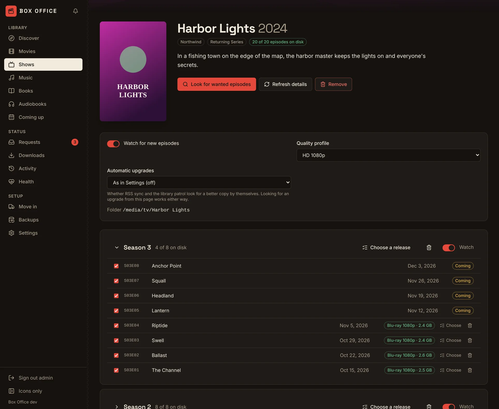
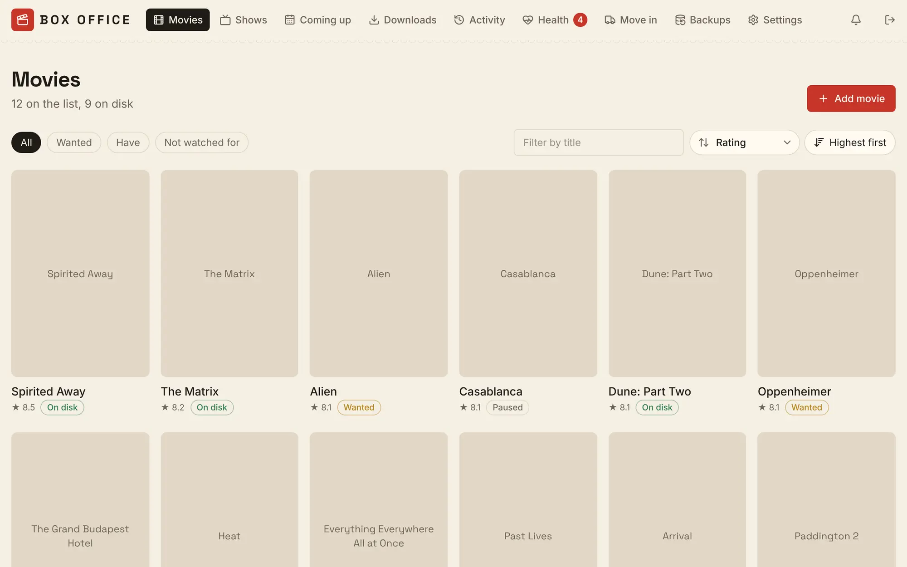
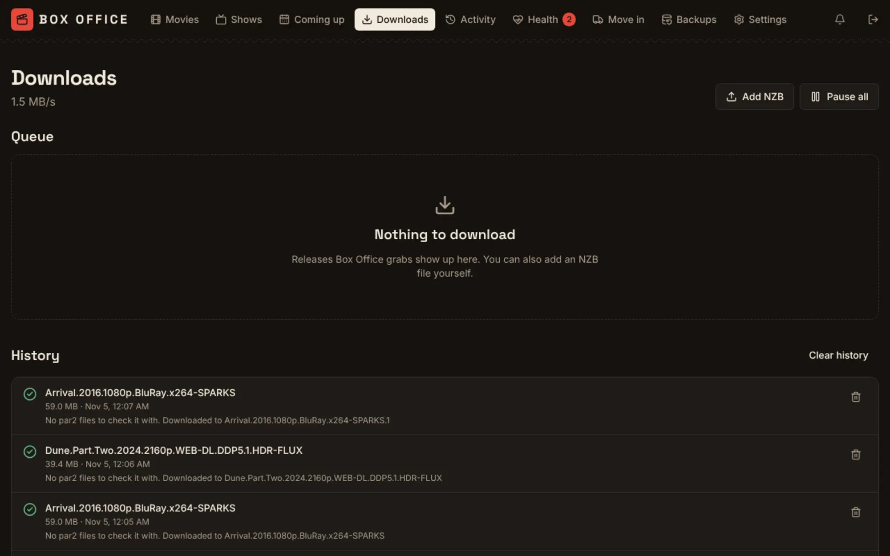
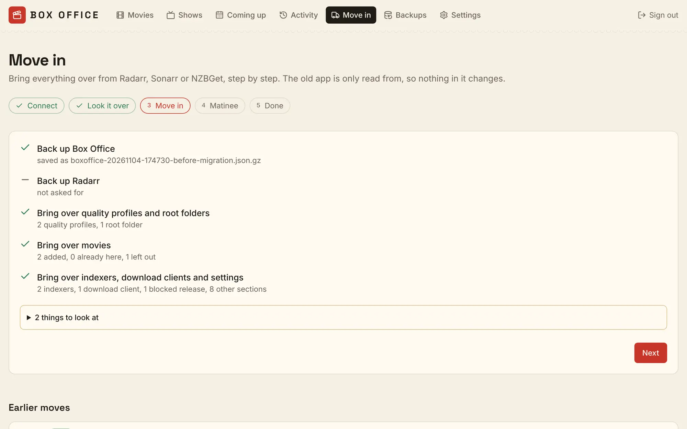
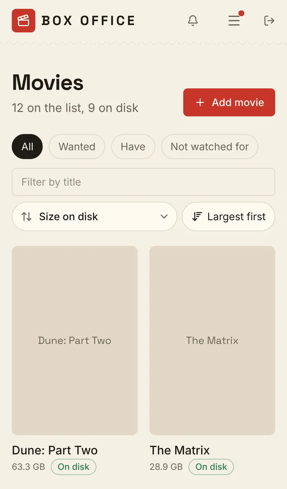
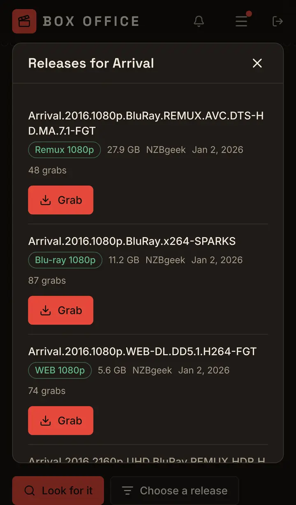

<p align="center">
  
</p>

<p align="center">
  <b>Finds, downloads and looks after your movies and shows.</b><br>
  One self-hosted app in place of Radarr, Sonarr and NZBGet, made to sit next to <a href="https://github.com/yeixio/matinee">Matinee</a>.
</p>

<p align="center">
  <a href="https://github.com/yeixio/boxoffice/actions/workflows/ci.yml"></a>
  <a href="LICENSE"></a>
  <a href="https://github.com/yeixio/boxoffice/pkgs/container/boxoffice"></a>
  <a href="go.mod"></a>
  <a href="https://github.com/yeixio/boxoffice/issues?q=is%3Aissue+is%3Aopen+label%3A%22good+first+issue%22"></a>
</p>

Box Office keeps a list of the movies and shows you want, searches your Usenet indexers for them, downloads and unpacks them itself, checks they're the real thing, and files them into your library. When a better copy turns up, it swaps it in and keeps the old one in a recycle folder.

Already running Radarr, Sonarr or NZBGet? **Move in** brings everything over step by step, and only ever reads from the old apps, so nothing in them changes until you decide to turn them off.



<p>
  
  
</p>

<p>
  
  
  
</p>

**Status:** early, and moving fast. Movies, TV, the built-in Usenet downloader and moving in from Radarr, Sonarr and NZBGet work end to end. There are no tagged releases yet: the `main` image is built from every change that passes CI. See the [roadmap](ROADMAP.md) for what's next.

## Contents

- [Try it in one line](#try-it-in-one-line)
- [What it does](#what-it-does)
- [Works with Matinee](#works-with-matinee)
- [Run it](#run-it): [Docker](#docker), [Docker Compose](#docker-compose), [Kubernetes](#kubernetes), [from source](#from-source)
- [Moving in from Radarr, Sonarr and NZBGet](#moving-in-from-radarr-sonarr-and-nzbget)
- [Configuration](#configuration)
- [FAQ](#faq)
- [How it's built](#how-its-built)
- [Contributing](#contributing)

## Try it in one line

```sh
mkdir -p data && docker run -d --name boxoffice -p 7272:7272 --user "$(id -u):$(id -g)" -v ./data:/data ghcr.io/yeixio/boxoffice:main
```

Open http://localhost:7272 and make the admin account. To have it file things into your library, mount your folders too: see [Docker](#docker).

## What it does

- **Movies and shows you want.** Add a title by name and Box Office looks it up on [TMDB](https://www.themoviedb.org/): poster, description, rating, and for shows every season and episode. Each title has a quality profile, a folder, and a switch to watch for it. **Coming up** lists new episodes and movie releases on their way.
- **Searches on its own.** RSS sync reads each indexer's new releases every 15 minutes, so new episodes are caught as they're posted. An hourly library patrol searches for a few missing titles and upgrades at a time, newest first, and searches a whole season when three or more of its episodes are wanted.
- **Kind to your indexers and your data plan.** Searches are spaced out and kept under each indexer's daily limit (read from the indexer when it says, or typed in), an indexer that's having trouble rests for a while, and a monthly **data cap** makes upgrades wait first, then missing titles, before you hit your internet provider's limit. Block accounts on news servers count down too.
- **A Usenet downloader built in.** No NZBGet or SABnzbd needed: Box Office connects to your news servers, downloads, checks and repairs with par2, and unpacks RAR sets, including ones with scrambled file names and old-style `.r00` volumes. Add an NZB yourself on the Downloads page, pause, reorder, retry, and act on many at once.
- **Checks what it downloaded.** Before anything reaches your library, Box Office looks inside: executables, files pretending to be videos, releases with no video, and "movies" far shorter than the real thing go to quarantine instead, the release is blocked, and another one is searched for. You can look through quarantine, release something from it, or delete it.
- **Files things neatly.** Finished downloads are moved into the title's folder, copied and checked by size first when the downloads folder is on another share. A file browser on the Downloads page lets you tidy the downloads folder or move a folder into a title by hand.
- **Upgrades without losing anything.** When a copy is below its profile's good-enough quality, Box Office keeps looking. A better copy replaces the old one, which goes to the library's `.recycle` folder. Empty those folders from Settings, or have them emptied after a number of days.
- **Choose a release yourself.** Every movie, episode and season has **Choose a release**: all the results from every indexer, with their quality, size, age and grabs, and why any were turned down.
- **Removes titles cleanly.** Removing a movie, show, season or episode can also delete its files from disk. You see the folder, the number of files and their size first, and Box Office deletes only what it showed you.
- **Sorts and filters** movies and shows by title, rating, size on disk, date added, and for shows by the next or last episode, remembered per list.
- **Health.** A check-up of the things that stop downloads working (disks, folders it can't write to, indexers, news servers), live charts of the processor, memory, requests and download speed, the log with a debug switch, and alerts. Prometheus metrics are at `/metrics` once you make a token.
- **Backups** of its database on a schedule, to its own disk and optionally to another folder (such as a NAS share) or S3-compatible storage (AWS S3, Backblaze B2, Cloudflare R2, MinIO). A passphrase encrypts them. Restore from the Backups page.
- **Works on a phone.** Every page is built to work at phone width, in light and dark.

## Works with Matinee

Box Office is the other half of [Matinee](https://github.com/yeixio/matinee), the free and open-source media server. Box Office gets the movies and shows; Matinee plays them.

<p align="center">
  <a href="https://github.com/yeixio/matinee"></a>
</p>

- **One connection.** In Matinee, open **Settings → Add-ons** and click **Connect** next to **Box Office**. Matinee finds it by itself in most setups; paste the API key from Box Office's **Settings → Connect Matinee**, then **Test** and **Save**. [Matinee's guide](https://github.com/yeixio/matinee/blob/main/docs/guide/server/radarr-and-sonarr.md#box-office) has the details.
- **Requests and coming soon.** People ask for movies and shows in Matinee's web player and apps, an admin approves, and Box Office finds them. Everyone sees what's coming in Matinee's Coming soon.
- **Notifications.** Matinee tells the person who asked when their title is found and when it's ready to watch, in the web player and the phone and TV apps. Admins hear about failed and quarantined downloads too.
- **Moving in switches Matinee over for you,** if you like: the last step of Move in points Matinee at Box Office in place of Radarr and Sonarr.

Box Office answers on Radarr's and Sonarr's APIs at `/radarr` and `/sonarr`, so tools built for Radarr or Sonarr can talk to Box Office too. Matinee is the one tested so far; reports on others (Overseerr, Jellyseerr, Home Assistant) are welcome. Matinee is optional, so Box Office fits Plex and Jellyfin setups as well.

## Run it

Box Office is one small binary with its web UI built in. The image has no shell and no FFmpeg: Box Office only talks HTTP and moves files. It listens on port **7272**.

Box Office needs to **write** to your library folders, because it files new downloads there. Mount them at the same paths Matinee (or Plex, or Jellyfin) sees them at if you can; then every app agrees on where a file is.

### Docker

```sh
docker run -d --name boxoffice \
  -p 7272:7272 \
  --user "$(id -u):$(id -g)" \
  -v ./data:/data \
  -v /path/to/movies:/media/movies \
  -v /path/to/tv:/media/tv \
  -v /path/to/downloads:/downloads \
  -e BOXOFFICE_DOWNLOADS_DIR=/downloads \
  ghcr.io/yeixio/boxoffice:main
```

Open http://localhost:7272, make the admin account, then in **Settings**:

1. Add `/media/movies` and `/media/tv` as root folders.
2. Paste a free [TMDB key](#faq) for posters and details.
3. Under **Downloads**, add a news server and an indexer, then turn on **Download releases**.

Or skip those and [move in](#moving-in-from-radarr-sonarr-and-nzbget) from Radarr, Sonarr and NZBGet, which brings all of it over.

`--user` makes Box Office run as you, so the files it writes are yours and it can write to folders you own. Without it, the container runs as user 65532. Make `./data` yourself first (`mkdir -p data`), or Docker makes it owned by root.

### Docker Compose

[`docker-compose.yml`](docker-compose.yml) runs Box Office and Matinee side by side, sharing the same library folders:

```sh
curl -fsSLO https://raw.githubusercontent.com/yeixio/boxoffice/main/docker-compose.yml
# change the /path/to/... folders in it, then:
mkdir -p boxoffice-data matinee-data
docker compose up -d
```

Box Office is at http://localhost:7272 and Matinee at http://localhost:7171. In Matinee, **Settings → Add-ons → Box Office** finds it at `http://boxoffice:7272`. Don't want Matinee? Delete its service from the file.

### Kubernetes

The Helm chart is in [`deploy/helm/boxoffice`](deploy/helm/boxoffice):

```sh
git clone https://github.com/yeixio/boxoffice.git
helm install boxoffice boxoffice/deploy/helm/boxoffice --set image.tag=main -f my-values.yaml
```

A small `my-values.yaml`:

```yaml
media:
  - name: movies
    mountPath: /media/movies
    volume:
      nfs: { server: nas.local, path: /export/movies }
  - name: tv
    mountPath: /media/tv
    volume:
      persistentVolumeClaim: { claimName: tv-library }

downloads:
  volume:
    persistentVolumeClaim: { claimName: downloads }

ingress:
  enabled: true
  hosts:
    - host: boxoffice.example.com
      paths: [{ path: /, pathType: Prefix }]
```

The chart runs one pod with SQLite on its own volume by default. Set `postgresql.enabled=true` for a bundled PostgreSQL (its password is made into a Secret on first install, so it works the same under Argo CD or Flux), or `database.url` for your own. Set `apiKey.existingSecret` and `tmdb.existingSecret` to manage keys with the cluster. Mount the same volumes Matinee reads, at the same paths. Everything else is in [`values.yaml`](deploy/helm/boxoffice/values.yaml).

`image.tag=main` is needed until the first release is tagged; the chart otherwise defaults to its `appVersion`. A reverse proxy or ingress in front of Box Office should allow long requests (an hour is plenty), because a big Move in preview takes a while.

### From source

Needs Go 1.26+ and Node 22 with pnpm.

```sh
git clone https://github.com/yeixio/boxoffice.git
cd boxoffice
make run    # builds the web UI and server, then serves http://localhost:7272 with data in ./data
```

## Moving in from Radarr, Sonarr and NZBGet

**Move in** (in the top bar) brings over everything an old app knows, one app at a time, without changing it:

1. **Connect.** Box Office looks for Radarr, Sonarr and NZBGet on their usual addresses and on this machine, and says what it found. Pick one, or type the address. For Radarr and Sonarr, paste the API key from the app's **Settings → General**; NZBGet uses its own username and password.
2. **Look it over.** Box Office reads the app and shows what would come across: how many titles are new, how many it already has, any it can't bring and why, and whether it can see the files at the paths the app uses. If the old app sees your library at another path (`/movies` there, `/media/movies` here), it works out the mapping from your mounts, or you can set it.
3. **Move in.** Box Office can back itself up first, so you can undo with a restore, and can ask the old app to back itself up and keep that copy. Then it brings over titles and their files, quality profiles, root folders, indexers, download clients, news servers, the blocklist, and the app's other settings. Radarr and Sonarr hide passwords and API keys from other apps; Box Office reads them from that backup, so keep it on.
4. **Matinee** (optional). Point Matinee at Box Office in place of Radarr and Sonarr, with an admin sign-in to Matinee that's used once and not kept. Skip this if you use Plex or Jellyfin.
5. **Done.** Your files stay exactly where they were: Box Office records them, it doesn't move them. Run both side by side for as long as you like, then turn the old app off.

Moving in again later is safe: titles already here are left as they are, and their ratings and details are filled in.

## Configuration

Most settings live in the web UI under **Settings**. The server itself takes a few flags or environment variables:

| Variable | Flag | Default | What it does |
| --- | --- | --- | --- |
| `BOXOFFICE_ADDR` | `-addr` | `:7272` | Listen address |
| `BOXOFFICE_DATA_DIR` | `-data` | `/data` in the image | Database (with SQLite), backups and the backups of apps you move in from |
| `BOXOFFICE_DATABASE_URL` | `-database-url` | empty | `postgres://…` to use PostgreSQL instead of SQLite |
| `BOXOFFICE_DOWNLOADS_DIR` | `-downloads` | `downloads` in the data folder | Where downloads go while they're fetched, checked and unpacked. Give it room for a few releases, and never point it inside a library |
| `BOXOFFICE_TMDB_KEY` | | empty | A TMDB key, used when none is saved in Settings |
| `BOXOFFICE_API_KEY` | | made on first start | Fixes the API key Matinee and other apps use, such as from a Kubernetes Secret |
| `BOXOFFICE_REFRESH_EVERY` | `-refresh-every` | `12h` | How often titles are refreshed from TMDB (at least `1h`) |
| `BOXOFFICE_LOG_FORMAT` | `-log-format` | `text` | `text` or `json` |
| `BOXOFFICE_DEBUG` | `-debug` | off | Log more. The Health page can also switch debug logging on and off while it runs |

**SQLite or PostgreSQL?** SQLite is the default and needs nothing else, as long as the data folder is on a local disk. Use PostgreSQL when the data would otherwise live on network storage, where SQLite's locking isn't reliable.

Kubernetes probes are at `/healthz` (process up) and `/readyz` (database reachable). The image runs `/boxoffice healthcheck` as its Docker health check.

## FAQ

<details>
<summary><b>Do I need Matinee?</b></summary>

No. Box Office works on its own and files things into ordinary folders, so Plex, Jellyfin, Emby or anything else can play them. Because it answers on Radarr's and Sonarr's APIs, request tools like Overseerr or Jellyseerr can point at `http://boxoffice:7272/radarr` and `/sonarr` with Box Office's API key (only Matinee has been tested this way so far). With Matinee you also get requests, notifications and the one-click connection.
</details>

<details>
<summary><b>Will moving in change or break my Radarr, Sonarr or NZBGet?</b></summary>

No. Box Office only reads from them. The one thing it asks for is a backup of the app itself, which it downloads and keeps. Files aren't moved or renamed. Keep the old app running until you're happy, but don't let both grab the same titles: once Box Office's **Download releases** is on, turn off searching in the old app.
</details>

<details>
<summary><b>Does it do torrents?</b></summary>

Not yet. Torznab indexers and torrent clients can be moved in and are kept, but Box Office only downloads from Usenet for now. Torrent support is on the [roadmap](ROADMAP.md).
</details>

<details>
<summary><b>Where do I get a TMDB key?</b></summary>

Sign up at [themoviedb.org](https://www.themoviedb.org/signup), open [Settings → API](https://www.themoviedb.org/settings/api), click **Create** and answer **Yes** to personal use. Copy the **API Key** (or the Read Access Token) into Box Office's **Settings → TMDB**. Box Office checks it and fills in artwork right away. Moving in from Radarr or Sonarr works without a key; artwork then comes from what those apps knew.
</details>

<details>
<summary><b>Will it eat my data cap or get my indexer account banned?</b></summary>

It's built not to. Searches are spaced two seconds apart and kept under each indexer's daily limit with a reserve for searches you start yourself; an indexer that errors or says "too many requests" rests and is tried again later. The monthly data cap is on by default at 3 TB: upgrades wait at 70%, missing titles at 90%, and downloads stop at 100%. Change all of it under **Settings → Downloads**.
</details>

<details>
<summary><b>Is anything ever deleted without asking?</b></summary>

Only under rules you can see and change. Replaced copies go to `.recycle` folders, which are kept until you empty them (or after a number of days you set). Downloads that fail beyond repair are deleted from the downloads folder unless you turn that off. Quarantined downloads are kept until you delete them, or for a number of days you set. Removing a title deletes its files only when you tick the box, and only the files the dialog showed you.
</details>

<details>
<summary><b>Can I run it on a NAS or Raspberry Pi?</b></summary>

Yes. The image is built for `linux/amd64` and `linux/arm64` and uses little memory, since it doesn't transcode anything. Unpacking big releases is mostly disk work, so put the downloads folder on a fast disk with room to spare.
</details>

<details>
<summary><b>Is there music, books or a request page of its own?</b></summary>

Not yet. Music (in place of Lidarr), books and audiobooks, and a simple request page for people who don't use Matinee are all on the [roadmap](ROADMAP.md).
</details>

<details>
<summary><b>Where do I report a problem?</b></summary>

[Open an issue](https://github.com/yeixio/boxoffice/issues/new/choose) with the version (shown at the bottom of each page) and what happened. The **Health → Log** tab can download the log; take out API keys, passwords and addresses before you paste it. Security problems go through [SECURITY.md](SECURITY.md).
</details>

## How it's built

One Go binary with the React web UI embedded. It stores everything in SQLite or PostgreSQL.

```
cmd/boxoffice          entry point
internal/api           HTTP API for the web UI, auth, serves the UI
internal/arrapi        Radarr- and Sonarr-compatible API at /radarr and /sonarr
internal/migrate       Move in: reading Radarr, Sonarr and NZBGet, previews, path maps
internal/search        Newznab searches, RSS sync, library patrol and indexer pacing
internal/downloader    the download queue, data cap, checks and moving into the library
internal/usenet        NNTP, yEnc, NZB, par2 repair, RAR unpacking and release screening
internal/catalog       movies, shows and episodes, and TMDB refreshes
internal/quality       qualities and profiles
internal/backup        backups to disk, another folder and S3, with encryption
internal/health        the check-up; internal/monitor and internal/alerts for the rest of Health
internal/notify        events Matinee passes on as notifications
internal/store         SQLite / PostgreSQL storage and migrations
web/                   React + Vite web UI
deploy/helm/boxoffice  Helm chart
```

The API under `/api/v1` is plain JSON over HTTP. `GET /api/v1/status` needs no sign-in and says which Box Office this is, which is how Matinee finds it.

## Contributing

Box Office is young, which makes it a good time to get involved: small fixes land quickly and big pieces (torrents, music, books, the request page) are still open to shape.

- **Start small.** Issues labeled [good first issue](https://github.com/yeixio/boxoffice/issues?q=is%3Aissue+is%3Aopen+label%3A%22good+first+issue%22) are well scoped and say where to start. [help wanted](https://github.com/yeixio/boxoffice/issues?q=is%3Aissue+is%3Aopen+label%3A%22help+wanted%22) has bigger ones.
- **No code needed.** Moving in from an unusual Radarr or Sonarr setup, a news server or indexer that behaves oddly, or a release Box Office got wrong: a [move-in report](https://github.com/yeixio/boxoffice/issues/new?template=move_in_report.yml) or [bug report](https://github.com/yeixio/boxoffice/issues/new?template=bug_report.yml) helps a lot.

[CONTRIBUTING.md](CONTRIBUTING.md) gets you from clone to a running server. Everyone follows the [Code of Conduct](CODE_OF_CONDUCT.md). What changed is in the [changelog](CHANGELOG.md).

## License

Box Office is licensed under the [GNU AGPL-3.0-or-later](LICENSE), like Matinee.
