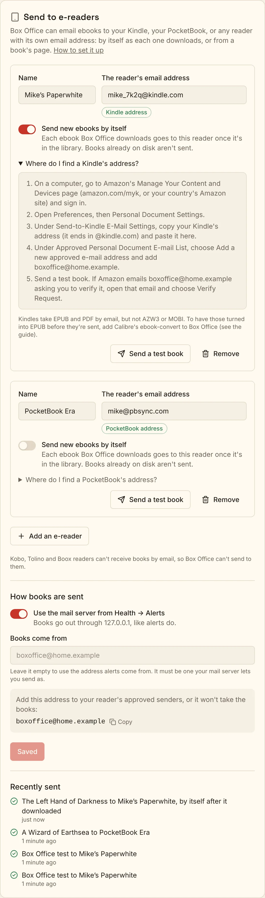

# Sending ebooks to e-readers

Box Office can email ebooks to your e-reader. Set up a reader once, and each
ebook Box Office downloads shows up on it by itself. You can also send any
ebook in your library from its page.

It works with any reader that has its own email address for receiving books:

| Reader | Its address looks like | Formats it takes by email |
| --- | --- | --- |
| **Kindle** (Send to Kindle) | `yourname_1234@kindle.com` | EPUB, PDF, and documents (DOC, DOCX, RTF, TXT, HTML). Not AZW3 or MOBI |
| **PocketBook** (Send-to-PocketBook) | `yourname@pbsync.com` | EPUB, PDF, FB2, MOBI, AZW3, DJVU and more |
| **Any other reader or app** that takes books by email | anything | Box Office sends the file as it is |

Box Office works out which kind of reader it is from the address, so all you
type is the address.

Kobo, Tolino and Boox readers can't receive books by email, so Box Office
can't send to them. See [Kobo and other readers](#kobo-and-other-readers).

  

## Before you start

- **Turn on Ebooks** in **Settings → More than movies and TV**. The
  **Send to e-readers** card appears in Settings once Ebooks is on.
- **Box Office needs a way to send email.** If you already get alerts by
  email (**Health → Alerts**), Box Office uses that mail server and there's
  nothing more to set up. If not, you can enter one just for e-readers: see
  [The mail server](#the-mail-server).

## Set up a Kindle

You need a computer or phone with a web browser, and the Amazon account your
Kindle is registered to.

1. In Box Office, open **Settings → Send to e-readers** and choose
   **Add an e-reader**.
2. Find your Kindle's address. Go to Amazon's
   [Manage Your Content and Devices](https://www.amazon.com/myk) page (or the
   same page on your country's Amazon site, such as amazon.co.uk/myk) and
   sign in.
3. Open **Preferences**, then **Personal Document Settings**.
4. Under **Send-to-Kindle E-Mail Settings**, each of your Kindles and Kindle
   apps has an address ending in `@kindle.com`. Copy the one you want and
   paste it into **The reader's email address** in Box Office. Box Office
   shows **Kindle address** under it when it recognises it.
5. Approve Box Office as a sender. Box Office shows the address books come
   from, with a **Copy** button, under **How books are sent**. On the same
   Amazon page, under **Approved Personal Document E-mail List**, choose
   **Add a new approved e-mail address**, paste that address, and choose
   **Add Address**.
6. Give the reader a name if you like (such as "Mike's Paperwhite"), and
   leave **Send new ebooks by itself** on to have every new ebook sent.
7. Choose **Send a test book**. A one-page book called *Box Office test*
   should appear on your Kindle within a few minutes (it needs Wi-Fi to
   download it).
8. Choose **Save**.

**Amazon may ask you to verify.** The first time a book arrives from a new
sender, Amazon sometimes emails that sender address asking you to confirm.
If a book doesn't show up, look in the inbox of the address books come from
for an email from Amazon, and choose **Verify Request** within 48 hours.

**Kindle formats.** Amazon takes EPUB and PDF by email and turns them into
Kindle books on its side. It doesn't take AZW3 or MOBI by email any more.
Box Office prefers EPUB when a download has a choice, so this rarely comes
up. If a book is only in AZW3 or MOBI, the send fails with a message saying
so, unless Calibre is installed (see
[Turning other formats into EPUB](#turning-other-formats-into-epub)). Files
over 50 MB can't go to a Kindle by email.

## Set up a PocketBook

1. In Box Office, open **Settings → Send to e-readers** and choose
   **Add an e-reader**.
2. On your PocketBook, open **Settings → Accounts and Synchronization →
   Send-to-PocketBook**. Sign in, or make an account. Your reader gets an
   address ending in `@pbsync.com`.
3. Paste that address into **The reader's email address** in Box Office.
4. Approve Box Office as a sender: add the address books come from (shown
   under **How books are sent**) to the approved senders in your
   Send-to-PocketBook settings. If you skip this, PocketBook emails you the
   first time a book arrives and you can approve it from there.
5. Choose **Send a test book**, then **Save**. Books land in the
   **Send-to-PocketBook** folder on the reader the next time it's online.

## Any other reader or app

Some readers and reading apps take books sent to an email address of their
own. Find that address in its settings or help pages, paste it in, and allow
the address books come from to send to it if the reader asks. Box Office
sends the ebook file as it is.

You can also put an ordinary email address here, such as your own, to get
each new ebook as an attachment.

## The mail server

Books go out by email, through a mail server you choose.

**Use the mail server from Health → Alerts** is on by default. Box Office
then sends books the same way it sends alerts, and you have nothing more to
type. Under **Books come from** you can give a different sender address, if
your mail server lets you send as it; leave it empty to use the alerts'
address.

To use another server, turn that off and fill in:

| Field | What to enter |
| --- | --- |
| **Username** | Usually your email address. For Gmail, iCloud, Yahoo and Fastmail addresses, Box Office fills in the server, port and connection for you |
| **Password** | Your mail password. Gmail and iCloud need an *app password* (see below) |
| **Mail server**, **Port**, **Connection** | Your provider's outgoing (SMTP) server. Usually port 587 with STARTTLS, or 465 with TLS |
| **Books come from** | The address books are sent as. Usually the same as the username. This is the address to approve on your reader |

**Gmail.** Turn on 2-Step Verification in your Google Account, then make an
app password at [myaccount.google.com/apppasswords](https://myaccount.google.com/apppasswords)
and paste it as the password. The server is `smtp.gmail.com`, port 587,
STARTTLS. Gmail sends attachments up to 25 MB.

**iCloud Mail.** Make an app-specific password at
[account.apple.com](https://account.apple.com) under **Sign-In and
Security → App-Specific Passwords**. The server is `smtp.mail.me.com`, port
587, STARTTLS.

**Other providers** list their SMTP server in their help pages. Your own
mail server works too.

The password stays on your Box Office server. It's never shown again in the
browser or sent anywhere but your mail server.

## What gets sent, and when

- **By itself.** With **Send new ebooks by itself** on, each ebook Box
  Office downloads is sent to that reader as soon as it's moved into the
  library, including ones you move in by hand from the Downloads page. Each
  book goes to each reader once: an upgrade to a better copy isn't sent
  again.
- **Books you already have aren't sent.** Turning a reader on doesn't send
  your whole library, and nor do books brought in by **Move in** or a
  root-folder **Scan**.
- **By hand.** Open a book under **Books** and choose
  **Send to** *your reader*. With several readers, pick one first. This
  sends the book even if it went to that reader before.
- **Audiobooks** are never sent.

**Recently sent**, at the bottom of the card, lists what went where, and
why anything couldn't go. The Health page's log has the same.

## Turning other formats into EPUB

If [Calibre](https://calibre-ebook.com)'s `ebook-convert` is installed where
Box Office runs, Box Office uses it to turn a book a reader won't take (an
AZW3 or MOBI going to a Kindle, say) into an EPUB before sending it. It
looks for `ebook-convert` on the `PATH`, or set `BOXOFFICE_EBOOK_CONVERT` to
its full path.

The official Box Office image doesn't include Calibre, which is large. When
it isn't there, books in those formats aren't sent to a Kindle, and
**Recently sent** says why. EPUB, the format most ebooks come in, needs no
converting.

## Kobo and other readers

Kobo, Tolino and Boox readers have no address to send books to by email, so
Box Office can't send to them. Ways to get books onto them:

- Copy books over USB from your ebook folder.
- On a Kobo, use the Dropbox or Google Drive sync built into newer models,
  with your ebook folder inside a synced folder.
- If you run Calibre-Web on your ebook folder, its Kobo sync can put new
  books on a Kobo over Wi-Fi.

## Troubleshooting

**The test book never arrives.**

- Check that the address books come from is on the reader's approved list,
  exactly as Box Office shows it.
- For a Kindle, look for a verification email from Amazon in that
  address's inbox.
- Make sure the reader is on Wi-Fi and syncing.

**"Authentication failed" or "username and password not accepted".** The
mail server turned down the password. For Gmail and iCloud, use an app
password, not your usual one.

**"The mail server doesn't offer STARTTLS".** Change **Connection** to TLS
and the port to 465, or the other way round.

**"Kindle doesn't take azw3 files".** Find an EPUB copy of the book (choose
**Choose a release** on the book), or install Calibre where Box Office runs.

**The file is too big.** Kindle takes files of up to 50 MB by email, and
many mail providers limit attachments to about 25 MB. Large PDFs and
illustrated books can go over; copy those over USB instead.
